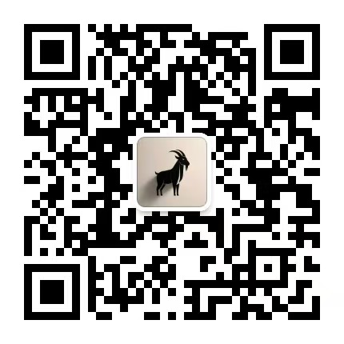

# 情绪的刀：两面都锋利

**当心吸食情绪的人：苦毒，虚荣，骄傲。**

# 1

自己从2023年开始，意识到有些事已经无解，情绪也渐渐绷不住，像一张网困住心态，脚步停在旷野的深坑。

**人生来都来了，不甘心就奋起挣扎。**

后来的三年寸步未进，越是处心积虑的算计，越是化为泡影和虚无。

心态和情绪也随之崩塌，很难和身边人好好说话，三五句过后就烦躁，接着开始阴阳怪气。

说起来也是抽象，怨天比尤人更甚。

人很难真正看清自己，因为心疼身边人不易，所以克制自己别过粪，情绪更偏向怨天。

**自己越假装隐忍，周围的亲友越心疼，越是怨天路越难走。**

心底的情绪像一把刀，自己和靠近的无一幸免。

持续站在身边的人，都是自己最亲近的人，情绪就像一片沼泽，试图诱导更多人掉进来。

我肯定没有被世界伤害，反而伤害自己的全世界。

没有人不处在痛苦叹息中，人心总意图掌控更多，就会试图算计更多，幻想寻找稳定的安全感，心态也会扭曲和失控。

**你想控制的越多，反向控制你的就越牢固。**

世界上的疾病至少有药可用，内心的状态却会无限蔓延，无论身边填多少人进去，都无法被彻底根治和控制。

情绪是否会被放大，取决于承接的环境。

在复杂浑浊的人群中，人和人一样感知不明显，身处干净温和的团体，就会是一把锋锐的刀，甚至肆意挥向身边人。

情绪患者自己陷入痛苦，连带把别人也拖进忧虑中。

**当前时代最大的命题：情绪病有没有解药？**

你若定意寻找必让你寻见，小心过程中可能拿到毒药，比如互联网的PUA诈骗犯，社交媒体的心灵毒鸡汤，像精神鸦片把持人的思维。

如何分析和判断其他人？只需要看清和承认自己。

谁内心世界不是地狱？充斥各种诡诈和黑暗，人性的本相是否显明，取决于伪装能力的强弱，在互联网被美化成认知。

你能对自我有清晰认知，别人只是从镜中观看的自己。

# 2

在群体生活环境里，特别像家的氛围感。

情绪患者容易成突破口，在不知不觉间制造问题，等到矛盾显明的时候，所有人才会后知后觉的害怕。

年轻人群中尤为常见，互联网在随时投喂焦虑。

在劳苦担重担的人群内，被几个情绪患者迷惑，不能抽出更多时间，陪伴正在遭苦难的家人，扶持忍受试炼的队友。

情绪也要定期劝勉，但终究是无限且无解。

在众多心态里以苦毒最甚，自己好不好根本无所谓，离近的一个都别想好，会不断生长扰害很多人。

**根往下潜伏向上结苦果，成为群体情绪的污染源。**

嫉妒更容易向内生发，看见群体其它人的优点，逐渐和自己形成对比，从而抵触客观的教导，导致骨中安静的朽烂。

**嫉妒伤害范围不大，却像一颗恶心的老鼠屎。**

骄傲最具有群体杀伤力，是从人心散发出来的恶念，对大部分普通人来说，经济能力和天赋水平，至少有一样是心中的刺。

天赋财富的差异效应，如同顽疾成为性格弱点。

虚荣心是想被看见和高举，组成小团伙增加存在感，不愿心存谦卑看别人强，无意中孤立要陪伴的新人。

把简单的群体人际关系，演变为名声和地位竞争。

贪婪会生发极强的物质欲，觊觎不属于自己的东西，幻想能拥有更多财富，忽略真正要追求的价值。

**当幻想演变成行为，手和心会伸向深渊。**

苦毒在心中扎根结果，会形成小范围爆炸伤害；嫉妒别人的获得，引发纷争与仇恨；骄傲把自己高高举起，在无声中伤害群体；虚荣贪图称赞与认可，无形中带节奏破坏氛围；贪婪的心永不满足，必然让人被欲望控制。

人群出现破坏性的情绪，若缺乏智慧的劝勉引导，像一把两面锋利的刀，谁碰上去都会出血。

**厌烦的事总有定时，察看管教从不误时。**

# 3

人操刀处理人群的情绪，需要智慧的语言，并且只能点到为止，不要引发直接的冲突。

你的心里能识别，但嘴里不要出判断。

**我是为你好的真诚，不能作为犯错理由。**

群体里的人和事交织影响，草蛇灰线且伏脉千里，没人能够从全局纵览，埋藏隐蔽又连贯的痕迹，所以轻轻提醒是尽本份。

也许开头一句闲笔，到结尾时才见真意。

真正的刀才能挥向根源，用风声惊动人的本心，才能快准狠的削掉情绪，重建内心世界的伤口，庖丁解牛又神乎其技。

**锋利无形的刀和手法，感知伤口的痛觉会延时。**

在电视剧庆余年中，有一句经典的台词：

把人心做战场，最为惊心动魄。

人的情绪只要高低切换，就会暴露出心底的弱点，容易成为被攻击的破口。

主体性很强的特征：存在无人打扰的平静，不管水穷处还是云起时，情绪不会爬高走低，生命散发干净的气质。

 

**2026.11.15**

 

微信搜索"三范式"或扫描二维码，即可订阅。

