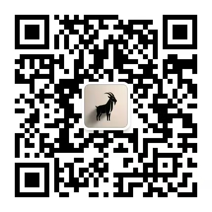

# 情绪围城，才是顶级的PUA

**殷勤保守自己的心，不断寻找脚前的灯。**

# 1

2026年的8月底，点开微信消息的链接，是朋友分享的社媒主页，用尽自己的意志浏览三分钟，实在是没法继续读下去。

**全屏漂着假大空的词汇，大脑瞬间被熏成臭豆腐。**

自己的思绪迅速成一堆乱麻，短暂的失去客观理性的判断，清醒一会过后再次打开，三分钟都无法坚持，会有强烈的反胃感涌现。

身为一个脚前有灯光的人，都能觉察到意识的迷乱。

作为超十年的资深网民，还是挺震惊这类行为，处心积虑的设计此等内容，给常人带去多少伤害不谈，连带PUA自己就很难绷。

**如果我去写类似风格，每周要给自己洗脑和洗胃。**

从账号主页的内容分析：非常典型的PUA类型笔记，瞄准情绪受伤的年轻人群，并且性别特征很明显，给自己贴上各种标签，靠星座分析和卖垃圾赚钱。

**出门在外身份自己给，互联网名片全靠造谣。**

内容整体想表达的方向：正常人完全看不懂它，所以误解它是在欺骗，不过它还是坚定的帮助粉丝，只要读者支付时间和金钱。

**明明是过粪的行为，却围着一群人推崇附和。**

互联网阴暗的角落里，还存在如此抽象的潮湿地带，于是花了两个月持续跟踪，大致看懂了手法的精妙。

**搭建一座坚固的围城，持续PUA受伤群体的情绪。**

背后的筹算堪称呕心沥血：表面上是在保护该群体，实际上是在限制心理出口，看似想给他们遮风挡雨，实则叫他们不见阳光。

真正头疼的问题是：朋友怎么都劝不动，待在围城里不愿醒来，在人看来实在是做不到。

**亲自越门打捞情绪肯定不行，好办法是环绕围城并注视它。**

# 2

制造情绪围城PUA一群人，非常精妙的设计和布局，正常人都能看出操刀手法，理清楚招摇的基本策略，却容易带偏受伤的人。

**像诡诈的狐狸走来走去，寻找可以被迷惑的情绪。**

核心IP设计再带几个托，制作挑拨情绪的内容，持续吸引受伤的人群，打乱人的正常意识和认知，反复压榨这群人的时间和金钱。

**明明操盘昧心的生意，偏偏称自己在看盘人生。**

**首先说围城圈选的目标**：情绪软弱认知混乱的人群。

人在心智不成熟的阶段，可能因为原生家庭变故，吃过难以下咽的苦，走过无法回头的弯路，心里留下不能磨灭的阴影。

**两种看似合理的相遇，夹杂精心设计的恶意。**

从底层理解这个人群，情绪没有共鸣和出口，容易被带偏走入误区，这不代表他们自身没责任，只能引导他们觉察问题，要做成这事不能单依靠旁人。

**迷途清醒自然千金难换，但一步错步步错是常态。**

**再说核心IP的人设造谣**：似乎是不知名物种投胎，安排到地球帮助失迷的人。

诚然好奇一个问题，爹妈知道从哪里捡的吗？

社媒账号采购一批僵尸粉，带几个活跃氛围感的托儿，反复制造过粪的垃圾内容，如果受伤的人群不幸踩中，会被情绪共鸣抓到，在多次互动后被彻底网住。

**人群抱团似乎成为情绪出口，却扼杀解决问题的时间窗口。**

岁月是人生最大的小偷，恍惚间过去几年的时光，也会偷走面对生活的勇气，最后伏在叹息中继续失迷。

**其次是固定的话术设计**：主页飘着各种能量，天道和天意，福报和感恩的心，业力与痛苦折磨。

此类话术有个特点，从路边随手牵只佩奇，都有可能匹配上几个词。

看不见抓不着的虚词，正常人花时间读几分钟，连打工人的身份都能忘记，只有修为高的可以驾驭，好难判断谁是修为高的那个。

**但可以断定粉丝修为低，是需要被帮助的有元人。**

更离谱的是为深陷的那批人，设计每个人的独立档案，根据他们点赞评论的互动，长期采集行为数据，利用AI的算法分析能力，深度分析各人的心理变化，做到PUA内容私人定制。

AI阅读档案后产出新内容，它们做的是半小时投喂一条。

主页全是表达混乱的内容，容易让人联想自己的处境，也许自己真的有这些标签，但那是某个时刻留的痕迹，要拉长时间线看清自己的本质，不能困在虚假的幻觉中。

**判断是对的要坚定持守，察觉到错误要懊悔改正。**

**然后扭曲价值观的认知**：强调对和错没有标准，号称性别不仅有男女，还存在中性和未知。

错从来都是错，对一贯都是对，没有标准是什么暴论？

PUA高明的地方正是在此，是非黑白不重要，东南西北不是方向，花钱跟随它的指引，可以重塑认知和价值观，才能看清宇宙的法则。

**它们设计的内容都是多面性，让人的意识在摇摆中停留。**

被情绪围困的人群，必然有面对的真实环境，或许选择可以有很多个，但是那个最好的决定，必然是窄且难的那条路，坦然面对并挥刀解决问题。

**最后获取利益壮大自身：**把手里的垃圾东西，造谣与道和术层面呼应，可以向人群卖出高溢价。

**他们误以为被捧在手心里，不过只是在它们的菜单上。**

从围城的人群疯狂获取利益，然后反向壮大和加固围城，从公开社媒猎取精准流量，再把人群封闭在私域社群，精心设计并且步步为营。

**关进去的都被长期观察过，不会背刺它们才是有元人。**

内部却又和谐稳定，形成抽象诡异的画面，不要恨恶它们的嘴脸，更不要厌烦他们的执念，都不明白自己在做什么。

**万事万物有周期，要醒的并不迟延。**

# 3

**长期PUA的结果就是：逃避现实的生活，远离真实的自己。**

他们无法彻底看清它们，把控制误认为陪伴，把对它们的依赖当亲密，心理按摩看成疗愈和认知，丝毫不能有效解决问题。

**迎合受伤人群的生意行为，说成帮助他们解答人生疑惑。**

显明在人心里才能知道，真正窥见一丝规律的人，心里必然存着敬畏等候，任凭事情发展和成就，就是常说的天机不可泄露。

在它们过粪的嘴里，话都是无法证伪的虚谈。

却引导想选择的人摇摆，牵引要执行的人纠结，将心态出口拉扯到它们身上，堵在情绪里反复的想，给内心不断制造混乱和依附，牵制他们无法走出情绪围城。

**最终让人群失去真实判断，越来越依赖它的解释与造谣。**

人如果只是站在旷野，尚可或向左或向右找路，但是身处旷野的深坑中，在反复挣扎里失去希望，用铁闩关上内心的铜门。

**当你寻见脚前灯光的那刻，默然回首根本不存在围城。**

那些身处旷野深坑的人，需要真诚有分寸的提醒，并在有光线的位置当坐标，给他们明确坚定的方向感。

**顺从各自内心的负担，该到谁那里去都要去，当说什么话都要说。**

不管处在什么环境中，总能寻到解决的办法，或者找到走出去的路，前提是做人总要信。

最后留个问题：围城背后的搭建者，又被困在哪座围城里？

 

**2026.10.18**

 

微信搜索"三范式"或扫描二维码，即可订阅。

