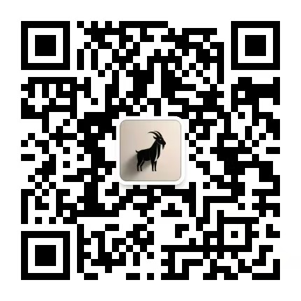

# 谁的旷野：不是烧心多年？

**直路出去最短最快，迷途弯路又长又慢。**

# 1

2023年意识到一个难题，自己站在旷野的深坑里，身边还是过去形成的废墟。

**脚步像被困在原地，觉察后的三年反复挣扎。**

虽然人的处境不一样，不过将人心比人心，就像从镜中观看自己，心路历程必然大差不差。

总有问题像死结，手无法解开，心不能接受。

死结会慢慢系在精神上，让自己觉得人生灰暗，想要抓其它的东西填补，或者放任心情肆意流浪，容易在不知不觉中迷路。

**等真正后悔的时候，难免一场怨天尤人。**

情绪挣扎的高低起伏，很容易产生疲惫状态，特别是看到一丝希望，伸手用力却抓不住，心态会一次次跌到谷底。

最初是起落起落，然后是起落落落。

直到脚下形成泥潭，坑的周边长出荆棘，想挣扎的意识彻底摆烂，心态被慢慢的烧焦烧穿，当你的心底没有灯光，被迫在旷野反复的探路。

等到心态彻底颓废后，自然也不怕开水烫。

自己时常陷入一种纠结，是不是从脚底的坑爬出去，以后的路就是平坦大道？可以像周围的人一样奔跑。

小学生都读过：山的那边还是山。

耳边持续有干扰声：无解的死结不可解，成为心底最锋利的刀。

每次挣扎到接近边缘时，充满希望的看一眼行人，都被烧心的声音打断：就算从坑里冲出去，你依然看不见出路。兜兜转转的过了三年

**人生是旷野不可怕，可怕的是知道身处旷野。**

2026年春节是心态绝境，真正的转机随之显明，真是应了那句老话：行到水穷处坐看云起时。

**脚底下是否存在旷野，只是从心发出的果效而已。**

# 2

走出旷野再回头望一望，会发现很多无奈的事，不管深坑还是泥潭：

有形成的必然，还有选择的偶然。

心存自由不被牵扯，方能轻松的面对人生难题：物质和精神两大追求，只有方向匹配统一时，才会找到最真实的自己。

**互联网环绕生活每个角落，眼目所见的远超心中妄想。**

AI三年的疯狂进化霸榜热搜，越来越多的人却开始追求真实，每天沉浸各种AI产品，仿佛身处巨大的虚空中，看不见抓不着却又存在。

再高级的智能模型，也比不上人心的善变。

人想不断追求的物质条件，纵然007也很难实现，只看自己没有而忽略拥有，脚步跟随本心不愿停下，最终都会步入必然的处境。

**维持好的生活和状态，本来就是当尽的本分。**

无奈旷野还存在恐怖袭击，明明身处同一片迷雾区，偏偏有人造谣他是向导，简直堪称荒野界的泥石流。

**瞎眼的陌生人，给烧心的你医脚。**

让已经非常难走的路，直接拐进精心搭建的围城，它会引导你沉迷情绪洪流，还顺手抽取你的钱包，在你的意识中编织各种网罗。

不断的聊能量福报业力，内容的观点多面且否定。

造谣自己各种抽象的人设，围猎心态崩溃过的人群，频繁用PUA话术拉扯情绪，直到扭曲价值观和心态，并从中获取巨大的利益。

**等到醒悟再回首时，岁月偷走的远不止这些。**

没人告诉你旷野有什么，哪一辈人的迷途都烧心，哪一个人的围城都坚固，逃离出去的最快方式：找到属于你的直路。

# 3

2016年初入职场，有个同事的签名写着：什么时候才是个头啊。克制深沉的表达内心挣扎，那会互联网还是暖阳。

2026年再看生活主页，账号离线签名没变。

每个被旷野围困的人，无一不是内忧外患的处境，风雨交加的时候，路上和坑底还有淤泥，让人不断跌倒或深陷。

**人比人如镜中观己，都在面对忧虑和恐惧。**

当你身旁经过许多人，探路和赶路必然不一样，站在迷途的人处心积虑，寻见直路的人欣然奔跑，方向不同终点自然不同。

在挣扎时别因羡慕，不管不顾的用力过猛。

人对没有或拥有的东西，总会产生错误的估值，得不到的容易产生执念，拿到手又不觉得珍贵，弯路变直不过一念间。

**当你的脚步踏进直路，发现依然有挣扎和风雨。**

**但内心多了份平静安稳，并且无人可以打扰。**

内心忧虑的窒息感，所处环境的压迫感，总能找到出路和解法，当对手是过去的自己，真正拷问灵魂的声音：

你该从哪里寻找帮助，才能游刃有余的赢自己？

 

**2026.10.25**

 

微信搜索"三范式"或扫描二维码，即可订阅。

