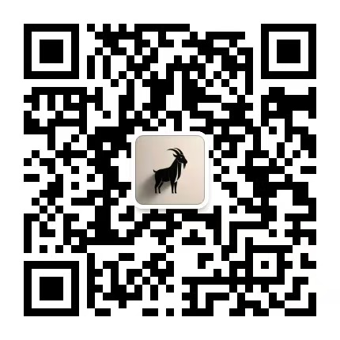

# 希望你也能轻松瘦下来

**松弛喜乐的心，堪称减肥的良药。**

# 1

**不废话先展示数据：今年4月195斤，今年11月135斤。**

期间控制饮食，真正只坚持6个月。

2016年初入职场，那时候体重还是140斤，转眼到2026年3月份，体重已经直奔200斤大关。

**按老家的话说：快达到出栏的标准。**

五花肉持续攻城略地，自己的每一个坏习惯，都有无法推卸的责任，特别是互联网行业的民工。

长期在电脑前打坐，体重完全管不住。

早上掐着点被床踹下来，直奔公司楼下的便利店，拎着早餐在工位吃喝，吃完昏沉的坐半天，午餐点外卖拿到工位，一边吃一边追剧，下午摇摇欲睡又半天。

**资深牛马的对抗策略，频繁接开水跑厕所。**

艰难的撑到休息日，必须依靠大吃大睡，恢复受伤的肉体和灵魂。

周五周六晚上必须熬夜，因为那才是自己的时间，周六周日睡到只吃一顿，这一餐的热量够耗上一周。

**偶尔下决心准备运动，不是加班就是下雨，甚至还会感冒发烧。**

职场牛马总是身心俱疲，频繁加班的民工更是如此，被生活裹挟着往前走，似乎没有跳出框架的契机。

今年改变的机会，堪称多条件奇妙组合。

年初心态被更新重塑，开始以喜乐面对生活，公司没有处在加班节奏，看着仿佛拿错的体检报告，于是随意的决定减肥，过去反复下过决心，喊口号阶段就以失败告终。

**自己也想试试：新心态是否超越旧意识。**

# 2

从五月到十月是天时，杭州的天气偏向燥热，起到压制食欲的效果，真正的决定性因素，必然是自己的饮食习惯。

**三餐吃什么很重要，时间节点同样关键。**

早餐尽量在8点之前，午餐尽量在1点之前，晚餐尽量在6点左右，如果在控制饮食阶段，维持饭前处于饥饿状态，每顿饭都吃的刚好不太饱。

当三顿饭在三个时间段，正常吃喝体重也变化小。

**第一个阶段：养成清淡饮食的习惯。**

荤菜首选清蒸类少吃红烧，素菜就是纯粹的蔬菜，水果只吃低糖粉的种类，没有奶茶甜品和夜宵选项。

除了有规律的三餐，杜绝一切其它食物。

早餐咖啡和牛奶或白茶，搭配水果或水煮蛋；午餐主食大米饭或者馒头，搭配一荤一素的菜系；晚餐轻食或者杂粮组合，搭配简单的素菜即可。

当坚持两周的时间，看到体重下降的正反馈，喜乐的心是坚持的动力。

习惯产生的果效出来，就会从被动转为主动。

掉体重进入正常节奏后，会因为饮食太过清淡，吃什么都觉得咸味很重，时间久了味觉才会适应。

**第二个阶段：控制主食份量和种类。**

在第一个时间段，早晚本来就吃得少，所以该阶段适当控制即可。

最关键的就是午餐，开始节制主食的份量，坚持每天少吃一口，或者稍微吃到不饿就行，三餐形成均衡的份量。

心一横撑到想要的重量，每周允许一顿多吃荤菜。

自己是从高体重减肥，该阶段持续六个月，达到130到140斤区间，即为完成预期的目标。

**第三个阶段：维持体重的区间范围。**

开始适当的恢复饮食，早餐每周吃两次杂粮，午餐选两顿不减主食，晚餐偶尔吃两碗清汤面，允许体重轻微的浮动。

养成新的饮食规律，照着本心吃吃喝喝。

过程的关键在于控制饮食，不过自己还有个习惯，每天晚上8点会散步一小时，总觉得散步可以放松身心。

**要去没有小摊的路上，防止五花肉赖着不走。**

在减肥的第一周，有天晚上没抗住饿，半夜11点吃了袋泡面，那顿夜宵的味道，至今也十分难忘。

# 3

过去也曾反复决定减肥，每次坚持上三五天，总是被各种行为诱惑，太忙太累就喝杯奶茶，心情特别差吃口甜食，加班到半夜必吃夜宵。

**如果我是我自己，为何偏偏管不住我？**

甚至是简单的一张嘴，更别提人心与人性，复杂到自己都看不清。

**甩掉食欲和肥胖并不难，斩掉不听话的老我才是争战。**

吃喝欲望不被控制，也会带来各种问题，要知道吃只为活着，但活着不能单纯为吃，饮食清淡身体健康，总比整天大吃大喝，身体冒出五花肉这个宿敌，还会慢慢成为健康隐患。

**每一个好习惯的养成，不过是1到2周而已。**

轻松不焦虑的减肥过程，没有吃甜品喝奶茶，面对大餐能管住食欲，饥饿时段能稳定读书，没有持续的意识挣扎。

**要知道在过去的十年，减肥口号喊了一遍又一遍。**

在新的人生状态里，有小到几乎看不见的信心，还存在无人打扰的平静。

 

**2026.11.07**

 

微信搜索"三范式"或扫描二维码，即可订阅。

